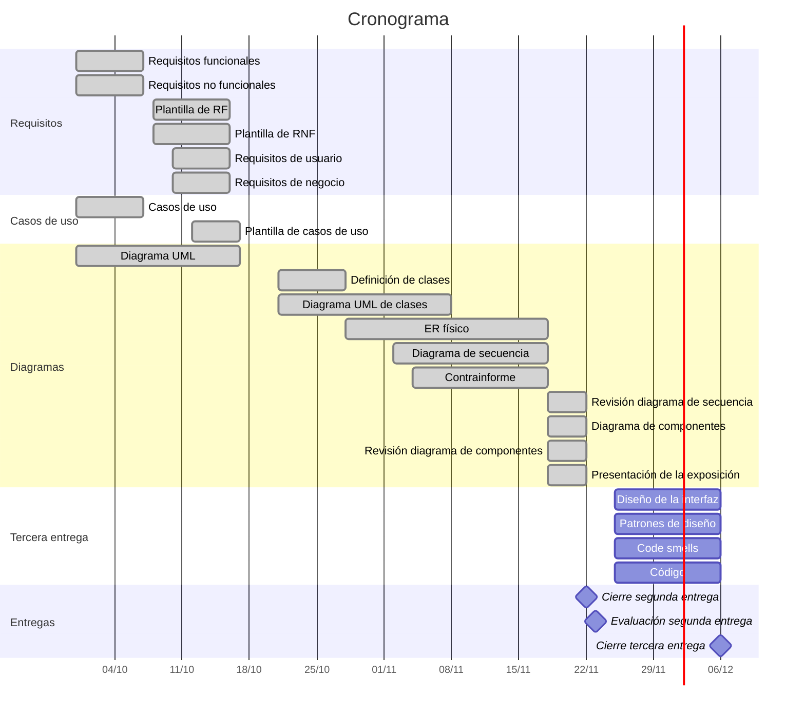

# Planificación

Cronograma de las tareas del proyecto, sincronizado con el tablero de Trello. Las reuniones semanales son los miércoles a las 10:45.

## Roles Scrum

| Rol | Integrantes |
|---|---|
| Scrum Master | Francis |
| Product Owner | Esperanza |
| Developers | Francis, Álvaro, Juan, Marcondes y Esperanza |
| Stakeholders | TurbineH, José Jesús de Benito Picazo (profesor) |

## Tareas

| # | Tarea | Responsables | Inicio | Fin | Estado |
|---|---|---|---|---|---|
| 1 | Requisitos funcionales | Francis, Álvaro y Juan | 30/09/2026 | 07/10/2026 | Revisado |
| 2 | Requisitos no funcionales | Marcondes y Esperanza | 30/09/2026 | 07/10/2026 | Revisado |
| 3 | Casos de uso | Francis, Álvaro, Juan, Marcondes y Esperanza | 30/09/2026 | 07/10/2026 | Revisado |
| 4 | Diagrama UML (reparto en [Diagramas/README.md](../Diagramas/README.md)) | Francis, Álvaro, Juan, Marcondes y Esperanza | 30/09/2026 | 17/10/2026 | Revisado |
| 5 | Redefinición según plantilla de RF | Francis, Álvaro y Juan | 08/10/2026 | 16/10/2026 | Revisado |
| 6 | Redefinición según plantilla de RNF | Marcondes y Esperanza | 08/10/2026 | 16/10/2026 | Revisado |
| 7 | Requisitos de usuario | Francis, Álvaro y Juan | 10/10/2026 | 16/10/2026 | Revisado |
| 8 | Requisitos de negocio | Marcondes y Esperanza | 10/10/2026 | 16/10/2026 | Revisado |
| 9 | Redefinición según plantilla de casos de uso | Francis, Álvaro, Juan, Marcondes y Esperanza | 12/10/2026 | 17/10/2026 | Revisado |
| 10 | Definición de clases | Francis, Marcondes y Esperanza | 21/10/2026 | 28/10/2026 | Revisado |
| 11 | Diagrama UML de clases | Álvaro y Juan | 21/10/2026 | 08/11/2026 | Revisado |
| 12 | ER físico | Francis y Marcondes | 28/10/2026 | 18/11/2026 | Revisado |
| 13 | Diagrama de secuencia | Álvaro, Juan y Esperanza | 02/11/2026 | 18/11/2026 | Revisado |
| 14 | Contrainforme | Francis, Álvaro, Juan, Marcondes y Esperanza | 04/11/2026 | 18/11/2026 | Revisado |
| 15 | Revisión del diagrama de secuencia | Francis, Esperanza y Álvaro | 18/11/2026 | 22/11/2026 | Revisado |
| 16 | Diagrama de componentes | Juan y Marcondes | 18/11/2026 | 22/11/2026 | Revisado |
| 17 | Revisión del diagrama de componentes | Francis, Esperanza y Álvaro | 18/11/2026 | 22/11/2026 | Revisado |
| 18 | Presentación para la exposición | Juan y Marcondes | 18/11/2026 | 22/11/2026 | Revisado |
| 19 | Cierre de la segunda entrega | Francis, Álvaro, Juan, Marcondes y Esperanza | 22/11/2026 | 22/11/2026 | Revisado |
| 20 | Diseño de la interfaz | Francis y Marcondes | 25/11/2026 | 06/12/2026 | Asignado |
| 21 | Patrones de diseño | Esperanza, Juan y Álvaro | 25/11/2026 | 06/12/2026 | Asignado |
| 22 | Code smells | Esperanza, Juan y Álvaro | 25/11/2026 | 06/12/2026 | Asignado |
| 23 | Código | Esperanza, Juan y Álvaro | 25/11/2026 | 06/12/2026 | Asignado |
| 24 | Cierre de la tercera entrega | Francis, Álvaro, Juan, Marcondes y Esperanza | 06/12/2026 | 06/12/2026 | Asignado |

> Los requisitos y casos de uso quedan abiertos a posibles cambios por modificaciones o requisitos adicionales.
>
> Fechas acordadas en la reunión del 28/10/2026 ([acta_28_10_2026.md](../Actas/acta_28_10_2026.md)) y actualizadas en la reunión del 04/11/2026 ([acta_04_11_2026.md](../Actas/acta_04_11_2026.md)): la revisión del diagrama de clases y del ER físico se pospone al 08/11/2026, la entrega del diagrama de secuencia al 11/11/2026 y el diagrama de componentes se retrasa a la espera del feedback del stakeholder. La semana del 16/11 al 22/11 el equipo la tuvo comprometida, por lo que en la reunión del 18/11/2026 ([acta_18_11_2026.md](../Actas/acta_18_11_2026.md)) se fijó el domingo 22/11/2026 como fecha límite para la revisión del diagrama de secuencia, el diagrama de componentes y su revisión, y la presentación de la exposición; la segunda entrega se cerró ese día y todas sus tareas están completadas.
>
> Tercera entrega: en la reunión del 25/11/2026 ([acta_25_11_2026.md](../Actas/acta_25_11_2026.md)) el equipo se divide en dos bloques independientes para ahorrar tiempo: diseño de la interfaz (Francis y Marcondes) y patrones de diseño, code smells y código (Esperanza, Juan y Álvaro). Todas las tareas de la tercera entrega están planificadas para terminar el 06/12/2026.

## Cronograma

| # | Tarea | Semana 1 30/09 – 07/10 | Semana 2 07/10 – 14/10 | Semana 3 14/10 – 21/10 | Semana 4 21/10 – 28/10 | Semana 5 28/10 – 04/11 | Semana 6 04/11 – 11/11 | Semana 7 11/11 – 18/11 | Semana 8 18/11 – 22/11 | Semana 9 25/11 – 02/12 | Semana 10 02/12 – 06/12 |
|---|---|:---:|:---:|:---:|:---:|:---:|:---:|:---:|:---:|:---:|:---:|
| 1 | Requisitos funcionales | 🟩🟩🟩 | | | | | | | | | |
| 2 | Requisitos no funcionales | 🟩🟩🟩 | | | | | | | | | |
| 3 | Casos de uso | 🟩🟩🟩 | | | | | | | | | |
| 4 | Diagrama UML | 🟩🟩🟩 | 🟩🟩🟩 | 🟩🟩🟩 | | | | | | | |
| 5 | Redefinición según plantilla de RF | | 🟩🟩🟩 | 🟩🟩🟩 | | | | | | | |
| 6 | Redefinición según plantilla de RNF | | 🟩🟩🟩 | 🟩🟩🟩 | | | | | | | |
| 7 | Requisitos de usuario | | 🟩🟩🟩 | 🟩🟩🟩 | | | | | | | |
| 8 | Requisitos de negocio | | 🟩🟩🟩 | 🟩🟩🟩 | | | | | | | |
| 9 | Redefinición según plantilla de casos de uso | | 🟩🟩🟩 | 🟩🟩🟩 | | | | | | | |
| 10 | Definición de clases | | | | 🟩🟩🟩 | | | | | | |
| 11 | Diagrama UML de clases | | | | 🟩🟩🟩 | 🟩🟩🟩 | 🟩 | | | | |
| 12 | ER físico | | | | | 🟩🟩🟩 | 🟩🟩 | 🟩 | | | |
| 13 | Diagrama de secuencia | | | | | 🟩 | 🟩🟩🟩 | 🟩🟩 | | | |
| 14 | Contrainforme | | | | | | 🟩 | 🟩🟩🟩 | | | |
| 15 | Revisión del diagrama de secuencia | | | | | | | | 🟩🟩 | | |
| 16 | Diagrama de componentes | | | | | | | | 🟩🟩 | | |
| 17 | Revisión del diagrama de componentes | | | | | | | | 🟩🟩 | | |
| 18 | Presentación para la exposición | | | | | | | | 🟩🟩 | | |
| 19 | Cierre de la segunda entrega | | | | | | | | 🟩 | | |
| 20 | Diseño de la interfaz | | | | | | | | | 🟦🟦🟦 | 🟦🟦 |
| 21 | Patrones de diseño | | | | | | | | | 🟦🟦🟦 | 🟦🟦 |
| 22 | Code smells | | | | | | | | | 🟦🟦🟦 | 🟦🟦 |
| 23 | Código | | | | | | | | | 🟦🟦🟦 | 🟦🟦 |
| 24 | Cierre de la tercera entrega | | | | | | | | | | 🟦 |

🟩 Revisado · 🟪 Hecho · 🟨 En progreso · 🟦 Asignado

